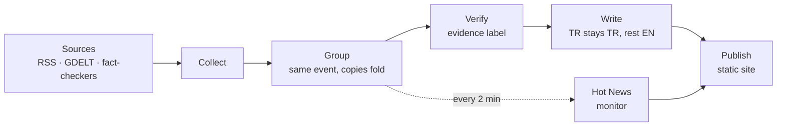

<div align="center">

# CSPNews

**A personal newsroom: verified world news in focused bulletins.**

[](https://github.com/MCantuncer/cspnews/actions/workflows/ci.yml)
[](https://github.com/MCantuncer/cspnews/commits/main)
[](https://github.com/MCantuncer/cspnews/pulls)


[](https://prettier.io)

[What it does](#what-it-does) · [How it works](#how-it-works) · [Schedule](#bulletin-schedule) · [Evidence labels](#evidence-labels) · [Getting started](#getting-started) · [Docs](#docs)

</div>

---

## What it does

CSPNews gathers news from around the world, checks every story against independent sources, and publishes short, focused bulletins at set times of the day. Each bulletin has three sections:

|     | Section                                                  | Language             |
| :-: | -------------------------------------------------------- | -------------------- |
| 🇹🇷  | **Turkish news**: the day's most important developments  | Turkish              |
| 🤖  | **Tech**: technology, with a focus on AI                 | English              |
| 🌍  | **Around the World**: major developments everywhere else | English (translated) |

Breaking stories don't wait: **Hot News** reaches the reader between bulletins, within minutes.

## How it works



## Bulletin schedule

All times are Istanbul time (UTC+3).

| Time     | Bulletin       |  Weekdays   |  Weekends   |
| -------- | -------------- | :---------: | :---------: |
| 07:30    | Morning (main) |     ✅      |     ✅      |
| 12:30    | Midday (side)  |     ✅      |      —      |
| 18:30    | Evening (main) |     ✅      |     ✅      |
| 22:30    | Late (side)    |     ✅      |      —      |
| Any time | Hot News       | every 2 min | every 4 min |

## Evidence labels

Every story shows how solid it is.

| Label             | Meaning                                                                                            |
| ----------------- | -------------------------------------------------------------------------------------------------- |
| **Confirmed**     | Two or more independent sources from different owners, or a primary source, with no contradictions |
| **Reported**      | Several sources, but they share an owner, a camp or wire copy                                      |
| **Single source** | Only one outlet has it                                                                             |
| **Disputed**      | Sources contradict each other, or a fact-checker rated it false                                    |
| **Developing**    | Hot News that is still being confirmed                                                             |

## Getting started

Requires Node 22 and pnpm.

```sh
corepack enable
pnpm install
pnpm check   # format, lint, typecheck and tests
```

## Deploying

The website is hosted on Vercel. [`vercel.json`](vercel.json) holds the whole setup, so importing the repository needs no settings: Vercel installs with pnpm, builds `@cspnews/web` and the packages it uses, and serves `apps/web/dist`. Only `main` is deployed, and only when a push changes something the site is built from ([`scripts/vercel-ignore-build.sh`](scripts/vercel-ignore-build.sh)); pull requests get no Vercel preview, because CI already builds them. To see a change before merging, run `pnpm --filter @cspnews/web dev:sample` locally. Bulletins are read at build time from `data/bulletins` (see [`apps/web`](apps/web/README.md)), so publishing a bulletin means committing it to `main`.

## Project structure

```text
cspnews/
├── packages/
│   └── core/        # shared types, schedule, source registry schema
├── apps/            # the website and the Hot News monitor (coming)
└── docs/
    ├── product/     # user stories and features
    └── design/      # design brief
```

## Docs

- 📖 [User stories](docs/product/user-stories.md): what the reader needs
- 🧩 [Features and shared systems](docs/product/features.md): what we're building, and in which release
- 📰 [Publishing a bulletin](docs/publishing.md): from feeds to the live site, step by step
- 🎨 [Design brief](docs/design/brief.md): the focus principles behind the interface
- 🤝 [Contributing](CONTRIBUTING.md): layout, conventions and how changes are made
